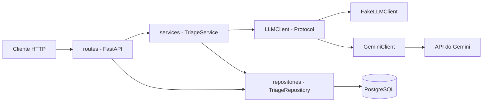
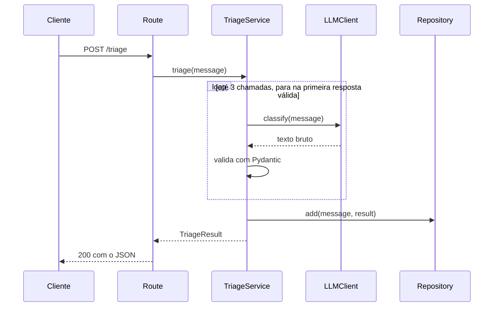

# API de Triagem de Mensagens com LLM

API que recebe a mensagem de um cliente em texto livre e devolve uma triagem estruturada, feita por um LLM:

- **category:** `late_delivery`, `billing`, `wrong_item`, `praise` ou `other`
- **urgency:** `low`, `medium` ou `high`
- **summary:** resumo em português, com no máximo 200 caracteres

Cada triagem é salva no PostgreSQL e pode ser consultada com filtros.

> Projeto de portfólio. **Todos os dados são fictícios.** Nenhum código ou dado de empresa real foi usado.

## O problema

Equipes de atendimento recebem mensagens em texto livre, e alguém precisa ler cada uma para decidir o que fazer e com que pressa. Este projeto automatiza essa primeira leitura.

A parte difícil não é chamar o LLM, e sim **confiar na resposta dele**. Um LLM pode inventar uma categoria, esquecer um campo ou devolver um JSON quebrado. Por isso a resposta é sempre validada, repetida quando vem fora do formato, e nunca salva sem passar pela validação.

## Arquitetura



Fluxo do `POST /triage`:



**Camadas, cada uma com uma responsabilidade:**

| Camada | Responsabilidade |
|---|---|
| `routes` | Receber HTTP e devolver a resposta |
| `services` | Regra de negócio: chamar o LLM, validar, repetir, mandar salvar |
| `repositories` | Único lugar que fala com o banco |
| `schemas` | Formato dos dados de entrada e saída (Pydantic) |
| `llm` | Contrato (`Protocol`) e clientes de LLM |

## Stack

Python 3.14 · FastAPI · Pydantic v2 · SQLAlchemy 2 · Alembic · PostgreSQL 16 · Docker Compose · Pytest · Ruff · Gemini (`google-genai`)

## Como rodar

### 1. Configurar o `.env`

```bash
cp .env.example .env          # no Windows (PowerShell): Copy-Item .env.example .env
```

Edite o `.env`:

- `POSTGRES_PASSWORD`: escolha uma senha, só com letras e números.
- `DATABASE_URL`: troque `SUA_SENHA` pela mesma senha.
- `GEMINI_API_KEY`: opcional. Crie em https://aistudio.google.com/app/apikey. Sem ela, use `LLM_PROVIDER=fake`.
- `LLM_PROVIDER`: `fake` (resposta fixa, sem custo) ou `gemini`.

O `.env` está no `.gitignore` e nunca vai para o repositório.

### 2. Opção A: tudo no Docker

```bash
docker compose up -d --build
```

Sobe o PostgreSQL e a API. A API aplica as migrations sozinha ao iniciar.

- API: http://127.0.0.1:8000
- Documentação interativa: http://127.0.0.1:8000/docs
- Banco, pelo seu computador: porta `5434`

### 3. Opção B: API local, banco no Docker

```bash
docker compose up -d db
python -m venv .venv
.venv\Scripts\Activate.ps1        # Linux/macOS: source .venv/bin/activate
pip install -r requirements-dev.txt
alembic upgrade head
uvicorn app.main:app --reload
```

### Testes, lint e avaliação

```bash
pytest -q                          # 29 testes, sem internet e sem custo
ruff check . && ruff format .
python -m eval.run_eval --fake     # linha de base, sem custo
python -m eval.run_eval            # usa o Gemini do .env (gasta cota)
```

## Exemplos de uso

### Criar uma triagem

```bash
curl -X POST http://127.0.0.1:8000/triage \
  -H "Content-Type: application/json" \
  -d '{"message": "Meu pedido está atrasado há 2 horas e ninguém me responde"}'
```

```json
{
  "category": "late_delivery",
  "urgency": "high",
  "summary": "Cliente reclama que o pedido está atrasado há 2 horas sem resposta."
}
```

No PowerShell, o `curl` é um apelido de outro comando. Use:

```powershell
Invoke-RestMethod -Method Post -Uri http://127.0.0.1:8000/triage `
  -ContentType "application/json" `
  -Body '{"message": "Meu pedido está atrasado há 2 horas e ninguém me responde"}'
```

### Listar triagens, com filtros e paginação

```bash
curl "http://127.0.0.1:8000/triages"
curl "http://127.0.0.1:8000/triages?category=praise"
curl "http://127.0.0.1:8000/triages?category=late_delivery&urgency=high&limit=10&offset=0"
```

```json
[
  {
    "id": 3,
    "message": "Adorei o entregador, muito simpático!",
    "category": "praise",
    "urgency": "low",
    "summary": "Cliente elogiou a simpatia do entregador.",
    "created_at": "2026-11-15T20:42:17.473900Z"
  }
]
```

As mais recentes vêm primeiro. `limit` aceita de 1 a 100 (padrão 50).

### Saúde

```bash
curl http://127.0.0.1:8000/health
```

### Erros

| Código | Quando | Exemplo de `detail` |
|---|---|---|
| `422` | Entrada inválida: mensagem vazia, só espaços, filtro com valor inexistente | Lista de campos com problema |
| `502` | O LLM falhou ou respondeu fora do formato após as tentativas | `"O LLM devolveu uma resposta fora do formato após 3 tentativas."` |
| `502` | Erro da API do Gemini (chave, modelo, limite de uso) | `"Modelo do Gemini não encontrado. Confira o GEMINI_MODEL no .env."` |
| `504` | O LLM demorou mais que o tempo limite | `"O Gemini demorou demais para responder. Tente novamente em instantes."` |

## Decisões tomadas

- **`Protocol` para o cliente de LLM.** O service só conhece o contrato `classify(message) -> str`. Trocar o Fake pelo Gemini, ou por um cliente de teste, não altera o service nem as rotas.
- **O cliente devolve texto bruto, e o service valida.** O LLM devolve texto, então o contrato é honesto sobre isso. Assim é possível testar respostas inválidas, e quem decide repetir ou falhar é o service.
- **Retry só para resposta fora do formato** (até 2 repetições, 3 chamadas no total). Outra tentativa pode acertar. Já erro de chave ou de limite de uso daria o mesmo resultado, então falha na hora.
- **Respostas inválidas nunca são salvas.** Só entra no banco o que passou pelo Pydantic.
- **`502` e `504` em vez de `500` para falhas do LLM.** O problema está no serviço externo, e quem chama sabe que o pedido dele estava correto.
- **Injeção de dependência com `Depends`.** A escolha do cliente de LLM e da sessão do banco fica em um único arquivo (`dependencies.py`), e os testes trocam as peças com `dependency_overrides`.
- **Prompt separado da mensagem do cliente.** As instruções vão em `system_instruction`, e a mensagem é tratada como dado a classificar. O prompt também pede que o conteúdo da mensagem nunca seja lido como instrução. Isso reduz o risco de injeção de prompt, mas não o elimina.
- **`temperature=0`** para que a mesma mensagem receba a mesma classificação.
- **Modelo configurável no `.env`.** Nomes de modelo mudam e saem de linha, como aconteceu durante o desenvolvimento.
- **SQLAlchemy 2 + Alembic.** O esquema do banco é versionado em migrations, e quem clonar o projeto reconstrói o mesmo banco. O SQL gerado foi conferido durante o desenvolvimento.
- **Consultas parametrizadas.** Filtros nunca são concatenados no SQL, o que evita SQL injection. O `limit` tem teto de 100.
- **Categoria e urgência salvas como texto**, validadas pelo Pydantic antes de salvar. Adicionar uma categoria nova não exige alterar um tipo dentro do banco.
- **Datas em UTC**, carimbadas pelo próprio banco.
- **Segredos só no `.env`.** `.gitignore` e `.env.example` foram criados antes do primeiro commit, a chave é um `SecretStr` (não aparece em logs) e o `.dockerignore` mantém o `.env` fora da imagem.
- **Mensagens e nomes em inglês no código e na API**, com o conteúdo do usuário em português.
- **Testes sem internet e sem custo.** O LLM é substituído por um cliente de teste, e o banco por SQLite em memória.
- **Imagem Docker com usuário comum** (não root), e `healthcheck` na API e no banco.

## Avaliação do modelo (`eval/`)

O script roda as 20 mensagens fictícias de `eval/dataset.json` (uma por chamada, **sem retry**, para medir o modelo puro) e mostra a taxa de acerto por campo. O último caso do dataset é uma tentativa de injeção de prompt.

Resultado em 2026-11-15:

| Métrica | Fake (linha de base) | `gemini-3.5-flash-lite` |
|---|---|---|
| Respostas válidas | 100% (20/20) | **100%** (20/20) |
| Acerto de categoria | 25% (5/20) | **100%** (20/20) |
| Acerto de urgência | 25% (5/20) | **85%** (17/20) |

O Fake responde sempre a mesma coisa e serve de piso. Os 3 erros do Gemini foram todos de urgência, com diferença de um nível (`medium` contra `high`, `low` contra `medium`), em casos em que o rótulo esperado é discutível.

**Leia estes números com cuidado:**

- São só 20 mensagens, escritas à mão. Acertar 100% aqui não quer dizer acertar 100% com mensagens reais.
- A urgência é subjetiva, e o rótulo esperado é uma opinião da autora.
- O resumo não é medido, porque não há resposta única certa.
- O resultado pode variar entre execuções e entre versões do modelo.

## Limitações

- **O resumo pode inventar detalhes.** O Pydantic confere o formato da resposta, não se o conteúdo é verdadeiro.
- **Reclamações sobre qualidade da comida caem em `other`**, porque não há categoria própria.
- **Sem autenticação.** Quem tiver o endereço da API pode criar e ler triagens.
- **As mensagens ficam salvas no banco.** Com dados reais, seriam dados pessoais e entrariam as regras da LGPD (base legal, retenção, anonimização). Aqui isso não se aplica porque tudo é fictício.
- **Camada gratuita do Gemini:** tem limite de uso por minuto e por dia, e os dados enviados podem ser usados pelo provedor para melhorar produtos. Por isso o projeto só usa dados fictícios.
- **Rotas e acesso ao banco são síncronos.** Para alto volume, o próximo passo seria `async` com cliente HTTP assíncrono.
- **Sem controle de taxa (rate limit) na API.**
- **Os testes usam SQLite em memória**, que é diferente do PostgreSQL em alguns detalhes. Não há testes de integração contra o Postgres real.
- **Dependências com versão mínima (`>=`) e sem arquivo de lock.** Duas instalações em datas diferentes podem pegar versões diferentes.
- **A migration roda ao iniciar o container.** Funciona com uma instância só. Com várias réplicas, seria melhor um passo separado.
- **A senha do banco aparece em dois lugares do `.env`** (`POSTGRES_PASSWORD` e `DATABASE_URL`).
- **O `eval` é pequeno e não roda em CI**, porque depende de uma chave de API e gasta cota.

## Estrutura do projeto

```text
app/
├── main.py               # monta o app
├── config.py             # configurações (.env)
├── database.py           # base dos models
├── dependencies.py       # injeção de dependência
├── error_handlers.py     # erros do LLM -> 502 e 504
├── routes/               # health.py, triage.py
├── services/             # triage.py (regra de negócio e retry)
├── repositories/         # triage.py (acesso ao banco)
├── schemas/              # triage.py (Pydantic)
├── models/               # triage.py (tabela)
└── llm/                  # base.py (Protocol), fake.py, gemini.py, errors.py
migrations/               # Alembic
tests/                    # pytest
eval/                     # dataset.json e run_eval.py
Dockerfile
docker-compose.yml
```

## Convenção de commits

Commits pequenos, no padrão [Conventional Commits](https://www.conventionalcommits.org/): `feat`, `fix`, `test`, `docs`, `build`, `chore`, `style`.
